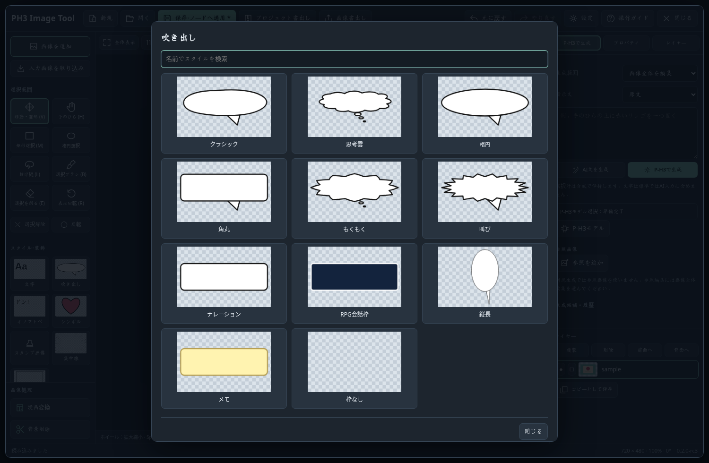
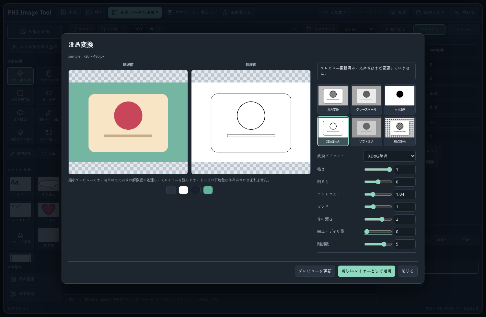
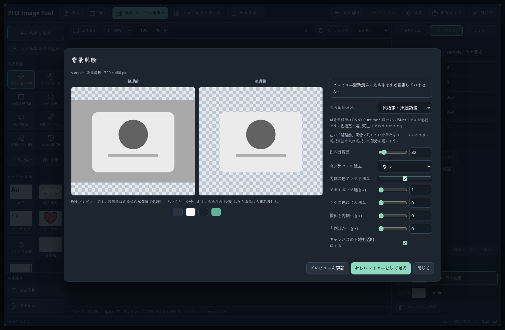
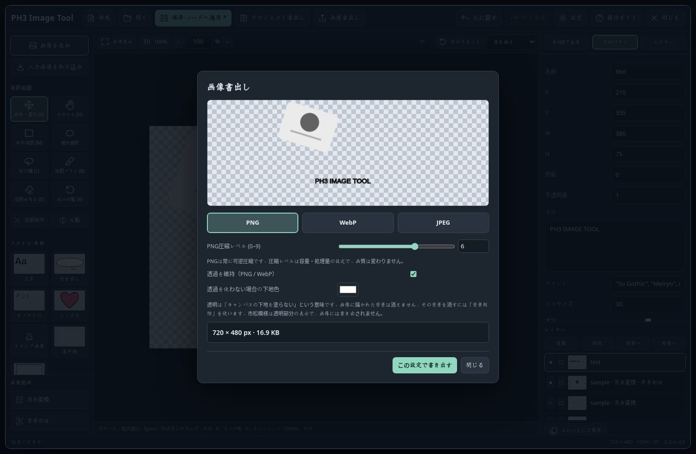

# 0.2.0-rc3 操作ガイド

## 更新と保存

前版で「保存・ノードへ適用」とComfyUIワークフロー保存を済ませてから、ComfyUIを終了し、同じカスタムノードフォルダーへ本版を上書きします。`user/default/ph3_image_tool` の作品データは削除しません。ComfyUI再起動後、ブラウザーをCtrl+F5で更新し、右下の `0.2.0-rc3` を確認してください。

ノードID `PH3ImageTool`、`image / alpha / selection`出力と作品形式1は維持しています。添付で確認された既存ワークフローは、そのまま使用する想定です。既存作品の画像・レイヤーに自動の描き直しや生成は行いません。

## グラフィカルなスタイル選択

左の「スタイル・装飾」で、文字・吹き出し・オノマトペ・シンボル・集中線・フレームを選びます。カードに見本を表示し、名前検索できます。文字とSFXは内容や色、フォントを後から変更できます。スタンプ画像では手元のPNG/WebPを追加します。

11吹き出し、16文字SFX、10シンボル、6集中線、8フレーム、6文字スタイルを含みます。元アプリの巨大なラスター素材集を丸ごと同梱したものではありません。フォントやモデルは同梱しません。

## キャンバスとショートカット

| 操作 | 動作 |
|---|---|
| ホイール | カーソル位置を中心に拡大縮小。Ctrlは不要 |
| Space+ドラッグ / 中ボタンドラッグ | 画像を変形せず、表示位置を移動 |
| H / 手のひら | 左ドラッグでも表示を移動 |
| R+ドラッグ / Alt+ホイール | 表示だけを回転。保存される画像やレイヤー角度は変えない |
| 0 / 表示リセット | 表示回転を0度に戻し全体表示 |
| Ctrl+0 / Ctrl+1 | 全体表示 / 100% |
| 角ハンドル | 比率を保ってサイズ変更。Shiftで自由変形 |
| 辺のハンドル | 一方向だけサイズ変更 |
| 緑のハンドル | 選択レイヤーを回転。Shiftで15度刻み |
| 吹き出しの黄色ハンドル | 尻尾の向き・長さを変更 |
| Delete / Backspace | 選択レイヤーを削除。ロック中は削除しない |
| Ctrl+Z / Ctrl+Shift+Z またはCtrl+Y | 元に戻す / やり直す |
| マウス「戻る」/「進む」 | キャンバスに届いたサイドボタン入力をUndo/Redoへ使用 |
| Ctrl+D / Ctrl+C / Ctrl+V | レイヤーの複製 / コピー / 貼付 |
| 矢印 / Shift+矢印 | 1px / 10px移動 |
| V / M / L / B / E / T | 移動・変形 / 矩形 / 投げ縄 / 選択ブラシ / 選択を削る / 文字 |
| [ / ] | ブラシサイズを増減 |

マウス側の設定やブラウザーにサイドボタンが先取りされる場合、すべての機器でUndoを保証することはできません。Ctrl+Zと上部ボタンも使えます。設定からサイドボタン割当を無効にできます。文字入力中はDeleteとUndoを文字編集に使い、IME変換中にキャンバスのショートカットを実行しません。

## 漫画変換

画像レイヤーを選び、「画像処理 → 漫画変換」を開きます。グレースケール、白黒2値、漫画、XDoG線画、ソフト漫画、網点漫画を実画像のプレビューで選べます。明るさ、コントラスト、ガンマ、線の濃さ、網点量、階調数などを調整できます。

前後比較の表示は縮小プレビューです。原寸適用時の線幅・細部と完全に同じ見え方を保証するものではありません。「新しいレイヤーとして適用」は、**レイヤーを縮小して配置していても元画像の解像度で処理**します。元レイヤーを非表示で残し、変形・不透明度を引き継いだ画像レイヤーを追加します。閉じるだけなら作品は変更されません。

元アプリのグレースケール/2値/漫画/XDoG計算を移植しています。旧版の6種類のCPUフィルターも選択肢として保持しています。これは別のQuick Retouch画面や漫画ページ編集を追加する変更ではありません。

## 背景削除

「処理前」の画像で背景をクリックして、削除する色の起点を選べます。色指定方式はその位置につながる似た色の領域を削除します。選択範囲方式は、キャンバスで選んだ部分を残します。必要に応じて、白/黒フチの除去、内側の色によるフチ補正、輪郭の収縮、内側ぼかしを調整します。

任意のISNet方式は、モデルとONNX Runtimeが既に導入されている場合のみ使用できます。プレビュー更新を明示的に押すまでAI処理を開始しません。モデルの取得・依存追加は行いません。ISNetの実推論は今回の検証対象外です。

## 「背景透明」の意味

**キャンバスの下地を透明にする設定**です。例えばキャンバスの一部に小さい画像を配置したとき、その外側を白く塗らず透明のままにできます。

画像ファイルの中に描かれている緑や白の背景を、自動で消す設定ではありません。その背景を取り除くときは「背景削除」を使います。市松模様は透明部分の表示用で、保存画像には入りません。

## 圧縮と書き出し

| 形式 | 設定と透過 |
|---|---|
| PNG | 常に可逆圧縮。0–9は圧縮量/処理量の設定で、画質は変わらない。透過を維持可能 |
| WebP | 非可逆時の品質1–100、可逆モードを選択可能。透過を維持可能。可逆時の品質値は圧縮処理量として使う |
| JPEG | 品質1–100。透過非対応のため、選んだ下地色へ合成して保存 |

書き出し画面のプレビューは実際に圧縮したデータです。表示容量はその実バイト数で、書き出し時も同じデータを保存します。エディターのレイヤー/マスク資産は引き続き可逆PNGで保持し、作品の繰り返し編集ではJPEG/WebP再圧縮を行いません。

**後段のSaveWebPMetaやSaveImageは別設定**です。通常の`image`出力はRGBなので、透明画像として直接保存する場合は本ツールのPNG/WebP書き出しを使用してください。エディターの書き出しにはComfyUIワークフローメタデータを自動埋め込みしません。再編集には`.ph3tool`を併せて保存します。

## このガイドの画面

画像は隔離Chromiumで、テスト用図形を使って実編集・CPU処理した画面です。実P-H3が生成した画像やGPU品質の見本ではありません。詳細は[検証記録](VALIDATION.md)を参照してください。
