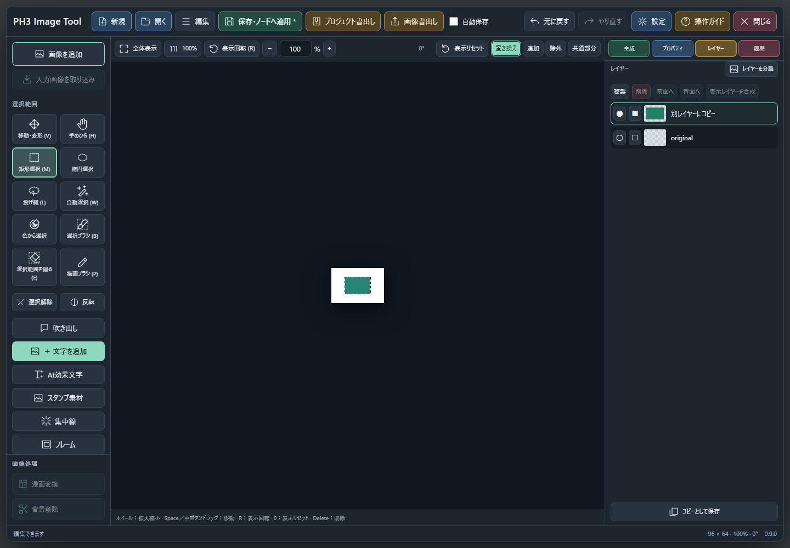

# ボタンの使用条件とマスクの整理（main）

2026-11-11。選択コピー/貼り付けの修正と組み合わせて、現在の編集状態に応じた操作の有効条件を整理しています。

- 選択→マスク：編集可能な画像と選択範囲があるときだけ有効。
- マスク解除：実際のレイヤーマスクがあるときだけ有効。切り抜き済み画像の透明部分は、マスク解除では復元できません。
- 選択解除・選択を削る・選択から除外・共通部分：選択範囲があるときだけ有効。選択が空になった後に除外/共通部分が残って選択できなくならないよう、置き換えへ戻します。
- レイヤーの削除/順序変更：対象の選択・ロック・前後の端を確認。対象なしや変化しない移動は無効。
- 画像処理・調整：対象画像・可視性・ロック・追加レイヤーの余裕を確認。
- コピー/切り取り：対象と可視性、選択部分を扱える種類を確認。切り取りはロックも確認。アプリ内貼り付けはコピー内容とレイヤー上限を確認し、外部画像のCtrl+Vは妨げません。
- 画像/文字/素材の追加、合成、生成候補の採用、参照追加：レイヤー/参照の上限を確認。
- 生成：モデル準備、全体/部分編集の入力画像、部分編集の選択範囲を確認。入力から除外される装飾だけでは画像編集を有効にしません。
- Undo/Redo・ノード入力：履歴や入力画像が存在するときだけ有効。

無効ボタンには日英の理由をtitle/aria-descriptionとして設定します。既存のモーダル内部のプレビュー・生成・採用・停止には元からある固有の有効条件を維持し、共通条件で無条件に有効化しません。実行時の検証や非同期競合の防止も残しています。

## 確認した意味と検証範囲

「選択→マスク」は元画像の選択外を隠す機能です。コピー/貼り付けで透明化済みの画像に同じ範囲をもう一度適用しても、画素の見た目は同じです。その作業では追加のマスク操作は不要です。

- Node 210件成功。
- 専用Chromiumの有効条件/マスク画素試験7項目成功（未処理例外0）。元画像への適用/解除、貼り付け済みの透明化、同一範囲の再適用、空の操作・ロック・前後端を確認。
- 既存のピクセルClipboard実ブラウザ試験9項目成功（Undo/Redo・移動・Cut/Paste・保存再開・archive・小型画面・半透明マスク）。
- 既存のブラウザ回帰15項目成功（保存直後編集・Undo/Redo・1025画像archive等）。新しい条件に合わせ、除外/共通部分のボタン試験では先に選択を作ります。

テスト専用プロジェクトとブラウザでの確認です。実ComfyUIへの接続、利用者作品の変更、P-H3/ISNet推論は行っていません。モデル設定、作品形式、元画像、コピー/貼り付けの処理は保持しています。修正と検証結果はmainへ反映しています。既存タグ・リリース・配布ZIPは変更していません。

## 検証証拠

[有効条件とマスク画素：7項目](verification/command-availability/availability.json) / [選択コピー・貼り付け：9項目](verification/command-availability/clipboard.json) / [保存・再読込等：15項目](verification/command-availability/editor-smoke.json)

