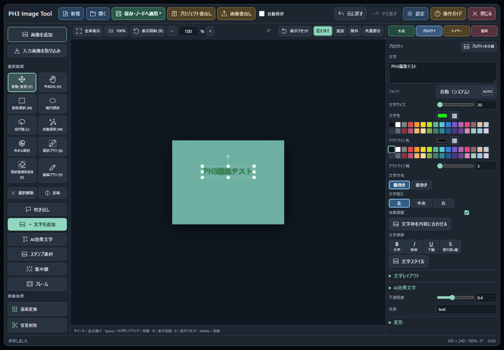
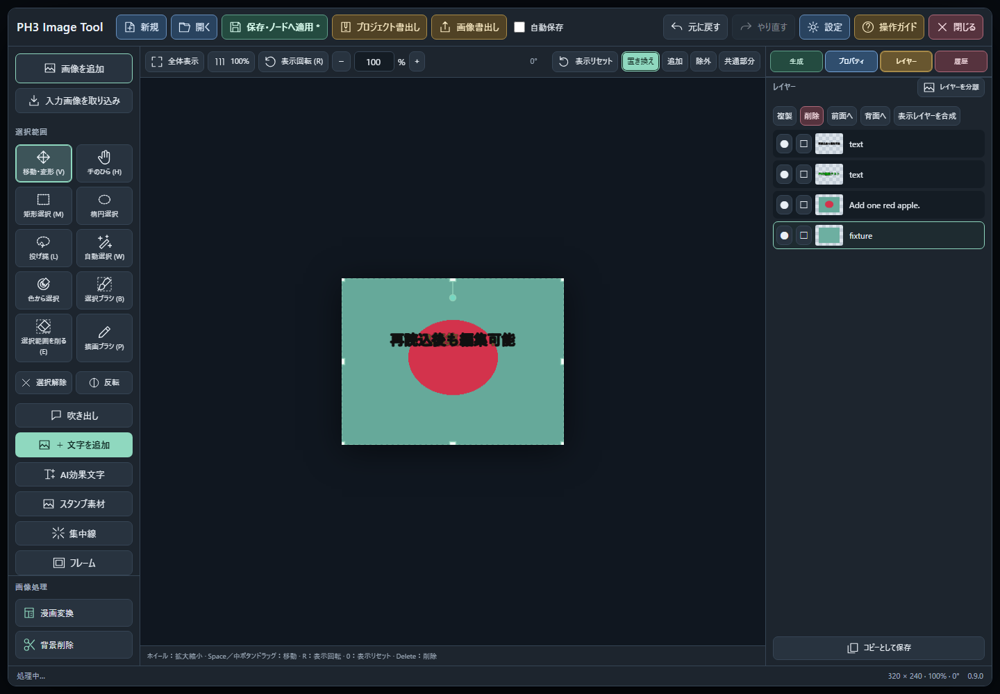
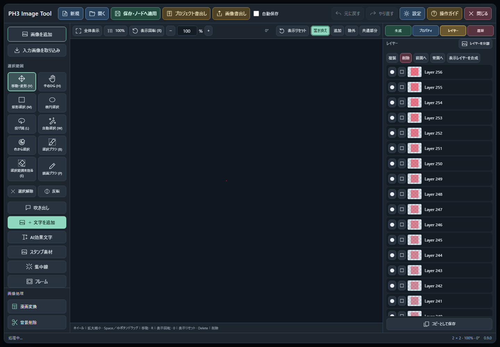

# ce59e89レビューへの対応（main）

2026-11-10。基準は `ce59e89b6e24dac451d6b82a354224e34718ef19`。

| 指摘 | 対応 |
|---|---|
| 保存後の最初の編集が消える | 保存応答で作品データを置き換えた直後、プロパティとレイヤーの入力処理を新しいオブジェクトへ結び直します。選択状態は保持します。 |
| 書き出したバックアップを読み込めない | 書出し/読込の最大件数を4,096エントリーに統一（画像4,095件＋JSON）。256レイヤー・1,025画像の作品も往復可能。書出しにも画像単体の64MiB、JSONを含む展開後サイズ、ZIP全体の256MiB制限を適用し、読込不可になるバックアップは成功扱いにしません。 |
| 閉じた漫画フィルターの結果が後から入る | 元画像アップロードの待機後にも画面の有効性と処理番号を確認。閉じる/古い処理の完了や失敗から適用・終了・エラー表示へ進みません。 |
| ブラウザテストの読込と古いUI参照 | 再帰的なdata URL置換を廃止。テスト専用URLへのPlaywrightルートで現在のファイルを返し、ブラウザ本来のバージョン付きimportを使用。現行の文字追加・選択方式・生成タブ等へシナリオを更新。保存直後の不透明度/色、Undo/Redo、作品再開、アーカイブ往復、模擬生成中編集を確認するシナリオにしています。 |

## 検証

- 修正前の実装へ追加のJavaScript回帰試験を当て、5件の失敗を確認。修正後は同じ5件を含む **203/203件成功**。
- **Python 158/158件成功**。256レイヤー/1,025画像の往復、件数上限、ZIPのオーバーヘッド、画像単体の上限を含みます。画像は2×2画素で、大画像の負荷試験ではありません。
- ブラウザ向けモジュールの全import参照を、現在のファイル/バージョン付きURLに沿ってたどる回帰試験を追加。ルートから返すバイトとCORS応答・パス範囲を検証。ブラウザ試験スクリプトはPython構文検査済みです。
- 元の画像、既存の編集、生成モデル/グラフ、ノードID/入出力、作品形式は変更していません。上限を超える場合は書出しを明示的に失敗させ、元の作品は残します。

## Playwrightでのブラウザ確認（2026-11-10追記）

利用者の承認を受け、テスト専用venvへPlaywright 1.65.0、専用フォルダーへChromium Headless Shell 158.0.8127.18を導入しました。普段のComfyUI用venv・製品の依存一覧は変更せず、既存の計算ライブラリを読み取り参照しています。

Windows上のテスト用Chromiumで **15/15項目成功、未処理のブラウザ例外0** を確認しました。

- 保存直後、マウスで不透明度スライダーをドラッグして作品へ反映。Undo/Redo各1回でその変更だけを往復。
- 保存直後の文字色変更を、色入力のinput/changeイベントで実ブラウザ上から確認（OS標準カラーピッカーの手動操作ではありません）。
- 実際のプロジェクト書出し/読込ボタンでバックアップを再読込し、文字の再編集・Undo/Redoと他レイヤーの保持を確認。
- 256レイヤー・1,025画像の作品もブラウザから書出し→再読込し、全レイヤーJSONと全画像参照が一致。保存時に更新される合成画像は、書出し直後の保存文書を基準に照合しています。画像は2×2画素で、大画像負荷試験ではありません。
- 漫画フィルターの元画像アップロードをブラウザ側で意図的に保留し、右上の閉じるボタンで終了→保留解除→アップロード完了後も作品JSONが不変。閉じずに待つ対照試験では、新規レイヤー適用に成功。
- 模擬生成の採用、生成中の編集保持、作品の保存/終了/再開も確認。

これは実際のブラウザとローカル保存・キャンバス処理を使った隔離試験です。稼働中ComfyUIへの接続、利用者作品の操作、実Chromeプロファイルの使用、P-H3/ISNetのGPU推論は行っていません。

導入先へ反映後は、作品を保存してComfyUIを再起動し、Ctrl+F5で読み直してください。修正と検証結果はmainへ反映しています。既存リリース・タグ・配布ZIPは変更していません。

## 検証証拠

[ブラウザ15項目の結果](verification/ce59e89-review/browser-results.json) / [256層・1025画像の往復](verification/ce59e89-review/boundary-roundtrip.json) / [閉じた後の遅延適用防止](verification/ce59e89-review/filter-close-race.json)

